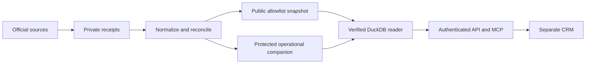

# Architecture

Official acquisition adapters write bounded, paced responses and source receipts outside Git. Pure normalization preserves source-native identity and derives stable canonical IDs. Reconciliation emits arbitrary ordered immutable run history, deltas, tombstones and predecessor hashes. A public allowlist produces the assessment-product Parquet/CAR output; protected attributes never enter that publication path.

Oracle owns source acquisition, normalization, provenance, query predicates, API/MCP and publication preparation. CRM owns map/lead workflow and natural-language intent. The copied 0.4.0 contract and shared predicate digest are checked; both endpoints preserve applied queries and deterministic ordering. Named places bind a source-derived center, place ID and index digest. Polygon containment is not silently substituted with a radius.

Runtime startup verifies file hashes, schemas, IDs and bindings. Full county raw JSON remains in lazy Parquet views; pinned offline validation plus exact non-binding-column equality proves the private rebind, avoiding a million-row JavaScript JSON parse at boot. Municipal source JSON is aligned with every assigned normalized observation. The hosted reader locks external access after its bounded file allowlist is established.

S3/CloudFront/API Gateway/Lambda provide a scale-to-zero read plane. Separate DynamoDB stores hold sessions, leads and durable request/model counters. Secrets Manager holds access material. The existing-account shared concurrency route is measured separately; account quota is not reserved capacity. Source acquisition is an operator job, never a model tool. [Security](SECURITY_PRIVACY.md) and [deployment](DEPLOYMENT.md) define these boundaries.
